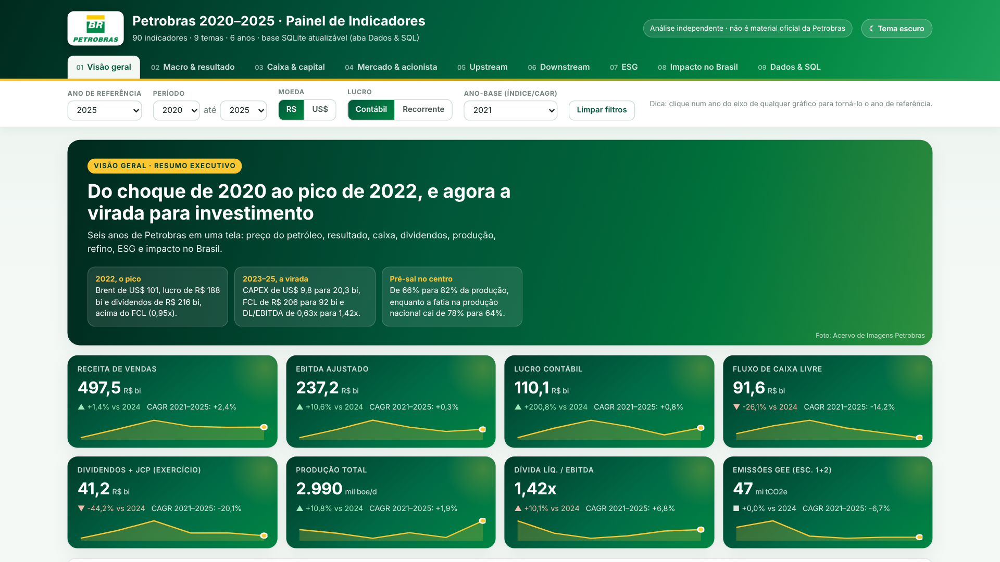
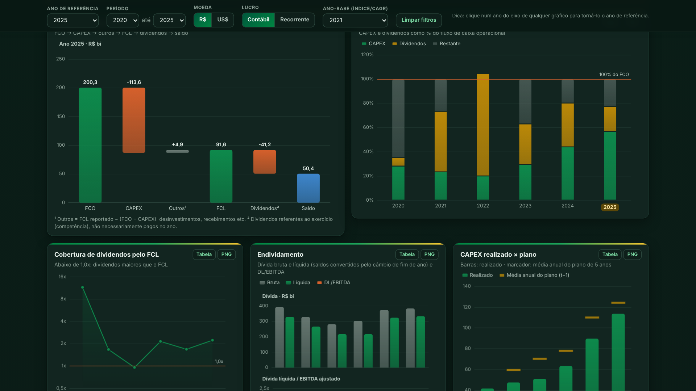
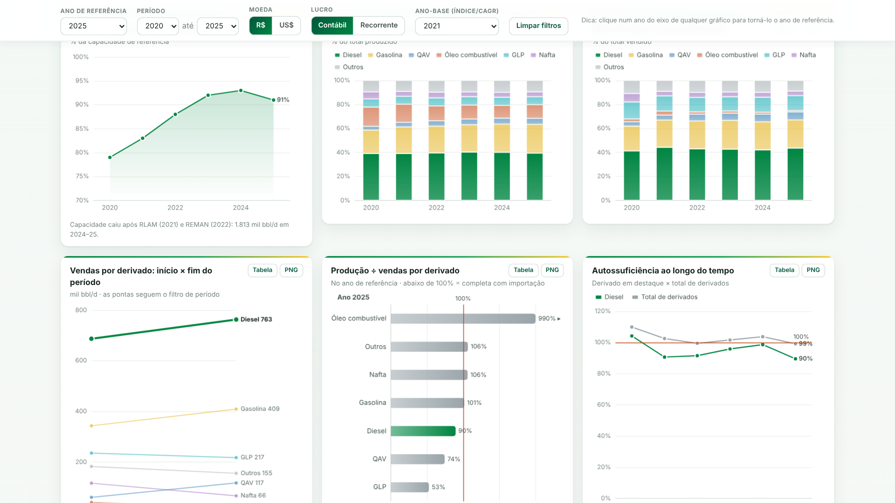

# Petrobras 2020–2025 · Dashboard de Indicadores

Dashboard interativo com **90 indicadores da Petrobras de 2020 a 2025**: preço do petróleo, resultado, caixa, dividendos, produção, refino, ESG e impacto no Brasil.

É **um único arquivo HTML** que funciona offline. A base de dados é um SQLite que roda dentro do navegador, e dá para editar com SQL na própria página.

**[▶ Abrir o dashboard](https://marcospiauhy.github.io/petrobras-dashboard-2020-2025/)** · [Vídeo de demonstração](docs/demo.mp4)



---

## O que dá para fazer

| Página | Principais análises |
|---|---|
| **01 Visão geral** | 8 KPIs com variação anual, CAGR e tendência; índice base 100; heatmap de variação anual |
| **02 Macro & resultado** | Receita e EBITDA × Brent; sensibilidade Brent × lucro; margens; lucro contábil × recorrente; EBITDA por barril; elasticidade ao Brent |
| **03 Caixa & capital** | Cascata do caixa (FCO → CAPEX → FCL → dividendos); destino do FCO; cobertura de dividendos; endividamento; CAPEX realizado × plano |
| **04 Mercado & acionista** | PETR4 e valor de mercado; P/L e EV/EBITDA; dividend yield; payout em três bases; LPA × DPA |
| **05 Upstream** | Pré-sal × demais; reservas e R/P; reposição de reservas; Brasil (ANP) × Petrobras |
| **06 Downstream** | Utilização das refinarias (FUT); mix de produção e de vendas; produção ÷ vendas por derivado; comércio exterior |
| **07 ESG** | Emissões e intensidades × metas; segurança (TAR e fatalidades); força de trabalho; diversidade |
| **08 Impacto no Brasil** | Tributos e royalties por esfera; R$ por dia; tributos por barril; produtividade |
| **09 Dados & SQL** | Console SQL, carregar e baixar `.db`, desfazer, esquema da base |

**Filtros globais:** ano de referência, período, moeda (R$/US$), lucro contábil ou recorrente e ano-base do índice e do CAGR. Também dá para clicar num ano no eixo de qualquer gráfico para torná-lo o ano de referência.
**Em cada gráfico:** ver a tabela com os números e exportar como PNG.
**Tema:** claro e escuro, com paleta validada para daltonismo.

<p>
  
  
</p>

---

## Principais achados

1. **2022 foi o pico de tudo.** Com o Brent a US$ 101, o lucro chegou a R$ 188 bi e os dividendos a R$ 216 bi, acima do fluxo de caixa livre (cobertura de 0,95x).
2. **De 2023 a 2025, a prioridade passou de dividendo para investimento.**
   - O CAPEX foi de US$ 9,8 bi para US$ 20,3 bi e já consome 57% do caixa operacional (eram 20% em 2022).
   - O FCL caiu de R$ 206 bi para R$ 92 bi.
   - O DL/EBITDA subiu de 0,63x para 1,42x.
3. **O pré-sal virou a empresa.** Ele foi de 66% para 82% da produção, e 2025 bateu recorde (2.990 mil boe/d). Ao mesmo tempo, a fatia da Petrobras na produção nacional caiu de 78% para 64%.
4. **O refino ficou mais eficiente.** A utilização (FUT) subiu de 79% para cerca de 92%, e o mix ficou mais nobre. Mas no GLP o refino cobre só cerca de 53% das vendas.
5. **ESG tem dois lados.** As emissões caíram de 62 para 47 mi tCO2e, mas a taxa de acidentes (TAR) piorou de 0,56 para 0,71.
6. **Impacto fiscal:** R$ 277,6 bi em tributos e participações governamentais em 2025, cerca de R$ 760 mi por dia.

> **Ressalvas:** são 6 pontos por série, então correlações e elasticidades são só descritivas. O CAGR com base em 2020 é inflado pela pandemia, por isso o ano-base padrão é 2021. "Tributos ÷ receita" mistura bases contábeis diferentes.

---

## Como usar

**Online:** abra o link do GitHub Pages lá em cima.

**Local:** baixe o `index.html` e dê dois cliques. Funciona sem internet; só as fotos de fundo dos banners precisam de conexão.

### Atualizando os dados com SQL

Na página **09 Dados & SQL**:

```sql
-- Corrigir um valor reportado (Receita de vendas 2025, em R$ bi)
UPDATE valor SET valor = 497.549 WHERE indicador_id = 17 AND ano = 2025;

-- Adicionar um novo ano
INSERT INTO valor (indicador_id, ano, valor, origem) VALUES
  (1, 2026, 65.0, 'Reportado'),   -- Brent médio (US$/bbl)
  (2, 2026, 5.40, 'Reportado');   -- Câmbio médio (R$/US$)
```

- **Recálculo automático:** os 34 indicadores derivados (margens, múltiplos, razões e totais; 31 calculados e 3 mistos) são recalculados sozinhos a partir dos valores reportados.
- **Atômico:** cada execução é uma transação só. Se der erro, nada é aplicado.
- **Para levar as alterações:** use **Baixar .db atual**. Para usar outra base, use **Carregar .db**.

---

## Estrutura do repositório

```
├── index.html                    # dashboard pronto (arquivo único, ~2,2 MB)
├── data/
│   └── petrobras_2020_2025.db    # base SQLite (90 indicadores × 6 anos)
├── src/
│   ├── template.html             # layout e CSS (temas claro/escuro)
│   ├── app.js                    # gráficos, filtros, KPIs, console SQL
│   ├── recalc.js                 # fórmulas dos indicadores calculados
│   ├── assets/logo.png
│   ├── build.py                  # gera o index.html
│   └── package.json              # dependências: echarts, sql.js
└── docs/
    ├── demo.mp4                  # vídeo de demonstração
    └── img/                      # prints usados neste README
```

### Modelo de dados

| Tabela | Conteúdo |
|---|---|
| `secao` | 9 temas (Macro, Mercado, Finanças, Petróleo & Gás, Refino, Comercialização, Investimentos, Sustentabilidade, Impacto Brasil) |
| `indicador` | nome, unidade, tipo (Reportado / Calculado / Misto), fórmula, fonte e nota |
| `valor` | um valor por indicador e ano, com a origem do dado |
| `fonte` | documentos de origem com URL |
| `constante` | total de ações usado no LPA e no DPA |
| `vw_base_longa`, `vw_tabela_larga` | views para BI (formato longo e largo) |

### Gerar o `index.html` de novo

Depois de editar algo em `src/` ou `data/`:

```bash
npm install --prefix src
python src/build.py
```

---

## Tecnologias

- **HTML, CSS e JavaScript puro**, sem framework
- **[Apache ECharts](https://echarts.apache.org/)** para os gráficos
- **[sql.js](https://sql.js.org/)**: SQLite compilado para WebAssembly, rodando no navegador
- **Python** para o build, que embute bibliotecas, base e logo num arquivo só

## Fontes dos dados

Relatórios de Desempenho, Formulário 20-F, Relatórios de Sustentabilidade e Planos Estratégicos da Petrobras (RI), ANP, BCB e B3. A lista completa com links está na tabela `fonte` e no rodapé do dashboard.

---

## Aviso

Análise **independente**, para fins de estudo e portfólio. **Não é material oficial da Petrobras.**

- A marca e o logo pertencem à Petrobras.
- As fotos dos banners são carregadas do [Acervo de Imagens Petrobras](https://petrobras.fotoware.cloud/fotoweb/).
- Alguns indicadores são calculados ou aproximados (veja a coluna `nota` na tabela `indicador`). Confira as fontes oficiais antes de usar em decisões.

## Licença

Código sob licença [MIT](LICENSE). Os dados vêm de fontes públicas e pertencem a seus respectivos autores.
